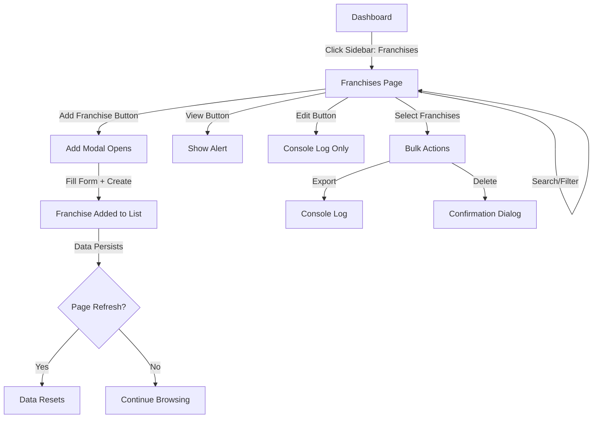
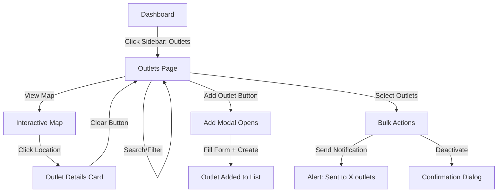
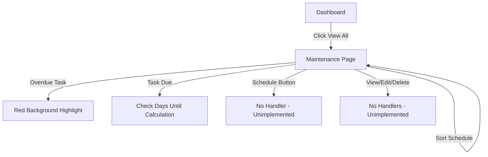
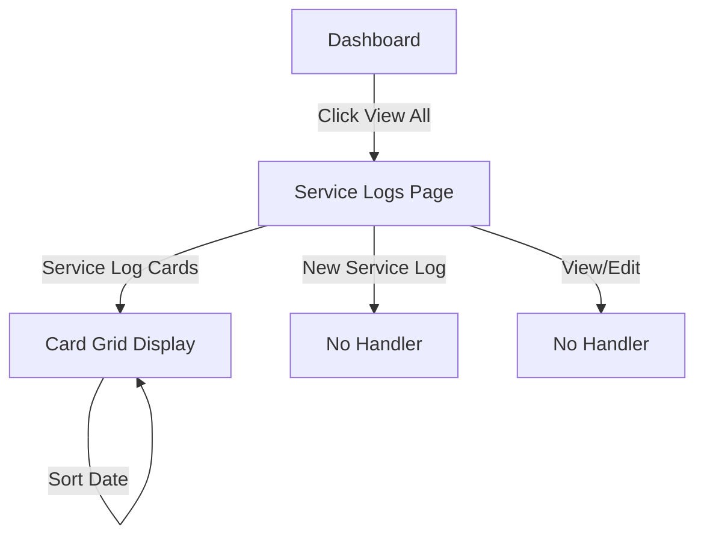
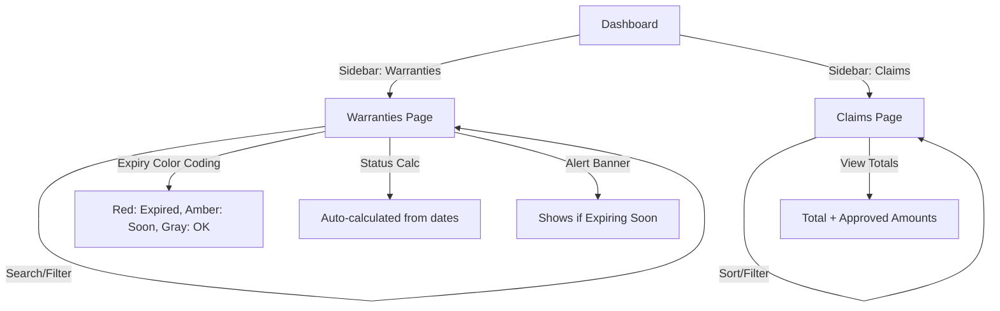
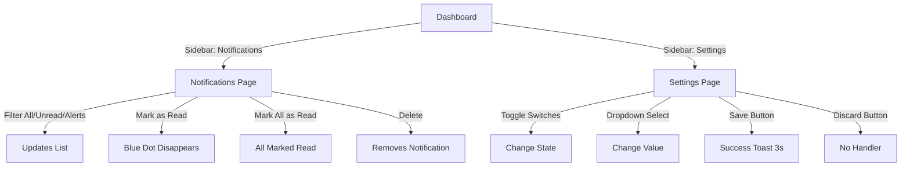

# FEPMS Navigation Flow & Structure

Complete guide to how users move through the application.

---

## Complete Route Inventory

### All Routes in the Application

| Route | Component | Page Title | Breadcrumb | Protected |
|-------|-----------|-----------|-----------|-----------|
| `/login` | Login | Login | N/A | ❌ Public |
| `/` | Dashboard | Dashboard | ["Dashboard"] | ✅ Protected |
| `/franchises` | FranchisesPage | Franchises | ["Management", "Franchises"] | ✅ Protected |
| `/outlets` | OutletsPage | Outlets | ["Management", "Outlets"] | ✅ Protected |
| `/equipment` | EquipmentPage | Equipment | ["Management", "Equipment"] | ✅ Protected |
| `/maintenance` | MaintenancePage | Preventive Maintenance | ["Maintenance", "Schedule"] | ✅ Protected |
| `/service-logs` | ServiceLogsPage | Service Logs | ["Maintenance", "Service Logs"] | ✅ Protected |
| `/warranties` | WarrantyPage | Warranty | ["Warranty Management", "Active Warranties"] | ✅ Protected |
| `/claims` | ClaimsPage | Warranty Claims | ["Warranty Management", "Claims"] | ✅ Protected |
| `/reports` | ReportsPage | Reports | ["Analytics", "Reports"] | ✅ Protected |
| `/notifications` | NotificationsPage | Notifications | ["Analytics", "Notifications"] | ✅ Protected |
| `/settings` | SettingsPage | Settings | ["Settings", "Preferences"] | ✅ Protected |
| `/profile` | ProfilePage | My Profile | ["Account", "Profile"] | ✅ Protected |
| `*` (any other) | NotFoundPage | 404 | N/A | ❌ Public |

**Protected Routes**: Require authentication via `ProtectedRoute` component
**Public Routes**: Accessible without login

---

## Navigation Architecture

### Three-Layer Navigation Structure

```
Layer 1: Authentication
├── Login → Dashboard (after login)
└── 404 Page (for invalid public routes)

Layer 2: Main Navigation (Sidebar)
├── Management (3 items)
├── Maintenance (2 items)
├── Warranty (2 items)
├── Analytics (2 items)
└── Account (2 items)

Layer 3: Secondary Navigation (Topbar)
├── Page Title
├── Breadcrumbs
├── Search/Filters
└── Action Buttons (Add, Export, etc.)
```

---

## Login & Authentication Flow

### Login Screen → Dashboard Navigation

```
Start at /login
    ↓
User enters credentials
    ↓
System validates (checks localStorage in mock mode)
    ↓
Valid? ✅
    ↓ YES
Redirect to / (Dashboard)
Session stored in localStorage
    │
    └→ NO: Show error message, stay on /login
```

### Registration Flow

```
At /login, click "Register" tab
    ↓
User enters: Name, Email, Phone, Password
    ↓
Click "Create Account"
    ↓
System validates:
- Email unique?
- Password 6+ characters?
- Passwords match?
- Name provided?
    ↓
All valid? ✅
    ↓ YES
Account created in localStorage
Automatic login
Redirect to / (Dashboard)
    │
    └→ NO: Show validation error, stay on Register tab
```

### Already Logged In

```
User visits /login directly
    ↓
System checks localStorage session
    ↓
Session exists? ✅
    ↓ YES
Redirect to / (Dashboard) automatically
    │
    └→ NO: Show login page normally
```

---

## Sidebar Navigation Structure

### Navigation Groups (In Order)

#### 1. Main (No Header)
- **Dashboard** (Path: `/`)
  - Icon: 🏠 Home icon
  - Badge: None
  - Active indicator: Dot on icon
  - Breadcrumb: ["Dashboard"]

#### 2. Management (Collapsible Group)
- **Franchises** (Path: `/franchises`)
  - Icon: 🏢 Building icon
  - Badge: 12 (franchise count)
  - Breadcrumb: ["Management", "Franchises"]

- **Outlets** (Path: `/outlets`)
  - Icon: 🏪 Store icon
  - Badge: 45 (outlet count)
  - Breadcrumb: ["Management", "Outlets"]

- **Equipment** (Path: `/equipment`)
  - Icon: ⚙️ Gear icon
  - Badge: 327 (equipment count)
  - Breadcrumb: ["Management", "Equipment"]

#### 3. Maintenance (Collapsible Group)
- **Preventive Maintenance** (Path: `/maintenance`)
  - Icon: 📅 Calendar icon
  - Badge: 8 (warning variant - yellow/orange)
  - Breadcrumb: ["Maintenance", "Schedule"]

- **Service Logs** (Path: `/service-logs`)
  - Icon: 📋 Clipboard icon
  - Badge: 142 (service log count)
  - Breadcrumb: ["Maintenance", "Service Logs"]

#### 4. Warranty (Collapsible Group)
- **Warranties** (Path: `/warranties`)
  - Icon: 🛡️ Shield icon
  - Badge: 23 (warning variant - yellow/orange)
  - Breadcrumb: ["Warranty Management", "Active Warranties"]

- **Claims** (Path: `/claims`)
  - Icon: 📄 File icon
  - Badge: 5 (claim count)
  - Breadcrumb: ["Warranty Management", "Claims"]

#### 5. Analytics (Collapsible Group)
- **Reports** (Path: `/reports`)
  - Icon: 📊 Chart icon
  - Badge: None
  - Breadcrumb: ["Analytics", "Reports"]

- **Notifications** (Path: `/notifications`)
  - Icon: 🔔 Bell icon
  - Badge: 3 (danger variant - red)
  - Breadcrumb: ["Analytics", "Notifications"]

#### 6. Account (Collapsible Group)
- **Settings** (Path: `/settings`)
  - Icon: ⚙️ Settings icon
  - Badge: None
  - Breadcrumb: ["Settings", "Preferences"]

- **Profile** (Path: `/profile`)
  - Icon: 👥 Users icon
  - Badge: None
  - Breadcrumb: ["Account", "Profile"]

### Sidebar Features

#### Desktop View
- **Sidebar Width**: 256px (w-64) expanded, 80px (w-20) collapsed
- **Position**: Fixed on left side
- **Toggleable**: Click hamburger icon or chevron to collapse/expand
- **Active State**: Highlighted background + icon dot for current page
- **Hover Effect**: Background color changes on hover
- **Badges**: Display count in colored badge (default, warning, danger)

#### Mobile View
- **Sidebar Width**: Full width (256px drawer)
- **Position**: Fixed, overlays content
- **Overlay**: Semi-transparent black overlay behind sidebar
- **Toggle**: Hamburger button in topbar opens/closes
- **Close**: Click overlay or navigation item to close

#### Group Collapse/Expand
- Each group header has expand/collapse toggle (chevron icon)
- Group state persists during session
- Click group title to toggle expand state
- When collapsed, group items still visible (not hidden)

### Sidebar Footer
- User avatar (initials in colored circle)
- User name
- User role
- Logout button (only visible in expanded view)

---

## Topbar Navigation

### Layout (Left to Right)

#### Left Section
- **Hamburger Menu** (mobile only)
  - Icon: ☰ three horizontal lines
  - Purpose: Toggle sidebar visibility on mobile
  - Shows on: Screens smaller than lg breakpoint

- **Page Title**
  - Displays: Current page name (e.g., "Franchises", "Dashboard")
  - Dynamic: Changes as user navigates

#### Center Section (Future)
- **Search Bar** (placeholder, not functional)
  - Placeholder text: "Search..."
  - Purpose: Search across all data (not yet implemented)

#### Right Section
- **Notification Bell**
  - Icon: 🔔 Bell icon
  - Badge: Red badge showing unread count (e.g., "3")
  - Click: Opens notifications dropdown (not implemented - links to /notifications)

- **User Dropdown Menu**
  - Shows: User avatar + name + role
  - Click: Dropdown opens showing:
    - User name and role
    - Profile link → `/profile`
    - Settings link → `/settings`
    - Logout button
  - Not implemented (links work but dropdown not visual)

- **Real-Time Clock**
  - Shows: Current time (HH:MM AM/PM)
  - Updates: Every minute
  - Format: 12-hour with AM/PM

---

## Breadcrumb Navigation

### Purpose
Helps user understand navigation hierarchy and current location.

### Structure
- Shows hierarchical path to current page
- Format: Breadcrumb1 > Breadcrumb2 > Breadcrumb3
- First breadcrumb is highest level

### Breadcrumb Paths (By Route)

| Route | Breadcrumbs |
|-------|------------|
| `/` | Dashboard |
| `/franchises` | Management > Franchises |
| `/outlets` | Management > Outlets |
| `/equipment` | Management > Equipment |
| `/maintenance` | Maintenance > Schedule |
| `/service-logs` | Maintenance > Service Logs |
| `/warranties` | Warranty Management > Active Warranties |
| `/claims` | Warranty Management > Claims |
| `/reports` | Analytics > Reports |
| `/notifications` | Analytics > Notifications |
| `/settings` | Settings > Preferences |
| `/profile` | Account > Profile |

### Breadcrumb Behavior
- **Clickable**: Each breadcrumb item may navigate (not fully implemented)
- **Read-only**: Currently shows path only (no back navigation via breadcrumbs)
- **Dynamic**: Updates when route changes

---

## Navigation Flow Diagrams

### Overall Application Flow

```mermaid
graph TD
    A[Login Page /login] -->|Valid Credentials| B[Dashboard /]
    A -->|Register New Account| C[Create Account]
    C -->|Account Created| B
    A -->|Already Logged In| B
    
    B -->|Click Sidebar Item| D[Main Pages]
    D -->|Franchises| E[/franchises]
    D -->|Outlets| F[/outlets]
    D -->|Equipment| G[/equipment]
    D -->|Maintenance| H[/maintenance]
    D -->|Service Logs| I[/service-logs]
    D -->|Warranties| J[/warranties]
    D -->|Claims| K[/claims]
    D -->|Reports| L[/reports]
    D -->|Notifications| M[/notifications]
    D -->|Settings| N[/settings]
    D -->|Profile| O[/profile]
    
    E -->|View All Link| E
    I -->|View All Link| I
    
    O -->|Click Logout| A
    N -->|Settings| N
    
    E -.->|Future Detail Page| P[Franchise Detail]
    F -.->|Future Detail Page| Q[Outlet Detail]
    G -.->|Future Detail Page| R[Equipment Detail]
```

### Franchise Management Workflow



### Outlet Management Workflow



### Maintenance Workflow



### Service Logs Workflow



### Warranty & Claims Workflow



### Notifications & Settings Workflow



### Profile & Logout Workflow

```mermaid
graph TD
    A[Dashboard] -->|Sidebar: Profile| B[Profile Page]
    B -->|View Mode| C[Read-only Fields]
    B -->|Edit Button| D[Edit Mode]
    D -->|Change Fields| E[Temp Changes]
    E -->|Save| F[Apply Changes]
    F -->|Cancel| G[Back to View]
    
    B -->|Logout Button| H[Clear Session]
    H -->|Redirect| I[/login Page]
    
    B -->|Change Password| J[No Handler]
    B -->|Delete Account| K[No Handler]
```

---

## Direct URL Access & Refresh Behavior

### What Happens When User...

#### Navigates Directly to URL
- `/` → Shows Dashboard (if logged in)
- `/franchises` → Shows Franchises page (if logged in)
- `/login` → Shows login form (or redirects if already logged in)
- `*` (any other) → Shows 404 Not Found page

#### Refreshes Page (F5 or Ctrl+R)
- **Session Status**: User remains logged in (session in localStorage persists)
- **Route**: Returns to same page (route preserved)
- **Data State**: All mock data resets to initial state
- **Form Data**: Any unsaved form data is lost
- **Filters**: Any active filters are reset

#### Closes Browser Tab & Reopens FEPMS URL
- **Session Status**: User remains logged in (localStorage persists)
- **Route**: Returns to whatever URL was bookmarked
- **Data**: Same as refresh

#### Closes Browser Completely & Reopens
- **Session Status**: User remains logged in (localStorage persists)
- **Route**: Depends on what URL they navigate to (app remembers last session)

#### Clicks Browser Back Button
- **Navigation**: Goes to previous page in browser history
- **Example**: On Franchises page → Click back → Goes to Dashboard

#### Tries to Access Protected Route Without Login
1. URL like `/franchises` accessed without session
2. `ProtectedRoute` checks authentication
3. Not authenticated → Redirects to `/login`
4. User must log in
5. After login, can access the page

---

## Search, Filter & Navigation

### Search Behavior
- Search input accepts text
- Filtering happens real-time (no submit button needed)
- Search is local/client-side (not API call)
- Searches across: Name, Code, Email, Contact person (varies by page)
- Results update instantly as user types

### Filter Behavior
- Filter dropdowns or buttons
- Selection applies immediately
- Multiple filters combine (AND logic)
- Example: Status=Active AND Type=Corporate
- Filters persist while on page (reset on navigation away)

### Pagination Behavior
- Page size selector changes items per page
- Navigation buttons go to next/previous page
- Goes back to page 1 when filters change
- Current page and total pages displayed
- Example: "Page 1 of 3" with << < > >> buttons

### Sorting Behavior
- Sort dropdown or column headers (varies by page)
- Sorting applies to current filtered results
- Sorts locally/client-side (not API)
- Ascending/descending (where applicable)

---

## Modal & Dialog Navigation

### Add/Edit Modals
```
Page Open
    ↓
Click Add/Edit Button
    ↓
Modal Dialog Appears (overlays page)
    ↓
User fills form
    ↓
Click Create/Save OR Cancel
    │
    ├→ Create/Save: Shows success message, modal closes, returns to page
    │
    └→ Cancel: Modal closes without saving, returns to page
```

### Confirmation Dialogs
```
User Action (e.g., Delete)
    ↓
Confirmation Dialog Appears
    ↓
User clicks Confirm OR Cancel
    │
    ├→ Confirm: Action performed, dialog closes
    │
    └→ Cancel: Action cancelled, dialog closes
```

### Modal Features
- **Overlay**: Semi-transparent background behind modal
- **Click Overlay**: Closes modal (cancel operation)
- **Focus**: Modal receives focus (keyboard accessible)
- **Persistent**: Modal stays open until explicitly closed

---

## Navigation Keyboard Shortcuts

### Current Status: Not Implemented
The following shortcuts are NOT currently available:
- Keyboard navigation between sidebar items (arrow keys)
- Keyboard shortcuts for common actions (Ctrl+K for search)
- Tab key for form navigation (standard HTML tab works)
- Enter key to submit forms (works by default)
- Escape key to close modals (works by default in some browsers)

### Future Implementation
Planned for Phase 2+:
- Quick search keyboard shortcut (Cmd+K / Ctrl+K)
- Sidebar keyboard navigation
- Modal dismiss with Escape key

---

## Error Navigation

### 404 Not Found
- Occurs when: User visits unmatched route (e.g., `/nonexistent`)
- Shows: 404 error page with description
- Options: "Go Back" button or navigate via sidebar

### Login Validation Errors
- Invalid email: "Please enter a valid email address"
- Invalid password: "Password must be at least 6 characters"
- Credentials don't match: "Invalid email or password"
- Registration errors: Various validation messages

### Form Validation Errors
- Shows: Error messages above/below fields
- Color: Red text or red border on field
- User can: Fix field and resubmit

### Missing Data Errors
- All pages gracefully handle empty data
- Shown: "No results" message
- Action: User can adjust filters or search

---

## Mobile Navigation Behavior

### Responsive Breakpoints
- **Mobile**: < 640px (sm breakpoint)
- **Tablet**: 640px - 1024px (md, lg breakpoints)
- **Desktop**: > 1024px (xl breakpoint)

### Mobile-Specific Changes
1. **Hamburger Menu**: Sidebar hidden by default, toggles with button
2. **Sidebar Overlay**: Full-screen drawer when open
3. **Topbar**: Condensed, more compact
4. **Tables**: May stack or scroll horizontally
5. **Modals**: Full-width or large on mobile
6. **Grid Layouts**: Single column on mobile, multi-column on desktop

### Mobile Navigation Flow
```
Mobile User
    ↓
Tap Hamburger Menu
    ↓
Sidebar Appears (full screen overlay)
    ↓
Tap Navigation Item
    ↓
Sidebar Closes (auto-close)
    ↓
Navigates to Page
    ↓
Content Displays Full-Width
```

---

## Summary Table: Navigation by Starting Page

| From Page | Via | To Page | Route | Notes |
|-----------|-----|---------|-------|-------|
| Login | Register | Account Created | /login | Auto-login then → Dashboard |
| Login | Sign In | Dashboard | / | Session stored |
| Dashboard | Sidebar | Franchises | /franchises | Breadcrumb updates |
| Franchises | View All Link | Franchises | /franchises | Already on page |
| Franchises | Add Button | Add Modal | N/A | Modal overlay |
| Any Page | Sidebar | Any Other | Route | Closes mobile sidebar |
| Any Page | Breadcrumb | Current | Route | No navigation |
| Profile | Logout | Login | /login | Session cleared |
| Notification | Mark Delete | Notification | /notifications | Removes item |
| Settings | Save | Settings | /settings | Success toast |
| Equipment | View | Equipment | /equipment | No handler |
| Any Page | Browser Back | Previous | History | Uses browser history |
| Any Page | URL Direct | Target | Route | If valid route |

---

## Actual vs. Potential Navigation

### ✅ Navigation That Works
- Login → Dashboard
- Sidebar navigation to all pages
- "View All" links from Dashboard
- Logout from Profile page
- Notification mark/delete actions
- 404 for invalid routes
- Browser back button
- Direct URL navigation

### ⚠️ Navigation That Partially Works
- Add/Edit/View buttons (modals exist but no detail pages)
- Bulk action buttons (show alerts but no full workflows)
- Modal dialogs (exist but don't persist)

### ❌ Navigation That Doesn't Work
- View buttons to detail pages (no detail page routes defined)
- Edit buttons to edit forms (no edit page routes defined)
- Export buttons to file download (no backend)
- Advanced filters (no implementation)
- Keyboard shortcuts (not implemented)
- Sidebar group collapse/expand (state not persisted)

### 🔮 Suggested Future Navigation
- `/franchises/:id` → Franchise detail page
- `/outlets/:id` → Outlet detail page
- `/equipment/:id` → Equipment detail page
- `/maintenance/:id` → Maintenance task detail page
- `/franchises/:id/edit` → Franchise edit form
- `/equipment/new` → Create new equipment form
- `/notifications/:id` → Notification detail page

---

## File References

**Routing Configuration**: `client/src/App.jsx`
**Protected Routes**: `client/src/components/ProtectedRoute.jsx`
**Sidebar**: `client/src/components/layout/PremiumSidebar.jsx`
**Topbar**: `client/src/components/layout/PremiumTopbar.jsx`
**Layout**: `client/src/layouts/PremiumDashboardLayout.jsx`
**Authentication Context**: `client/src/context/AuthContext.jsx`

